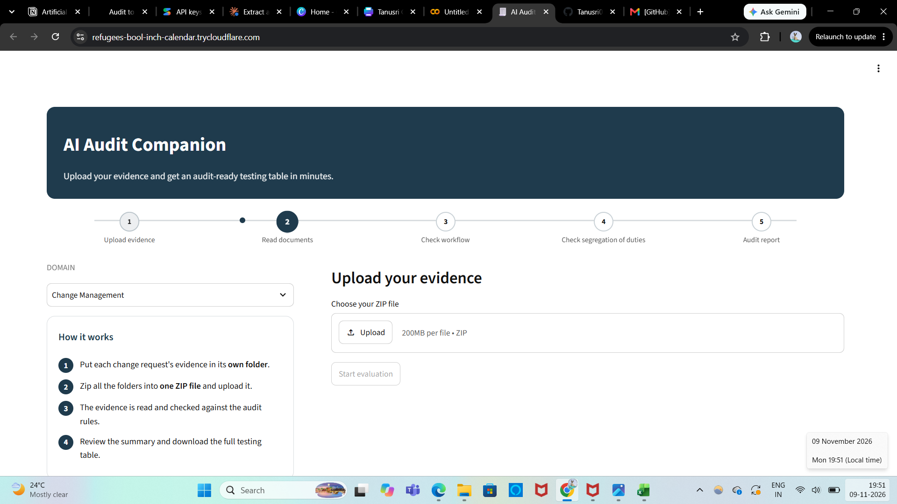
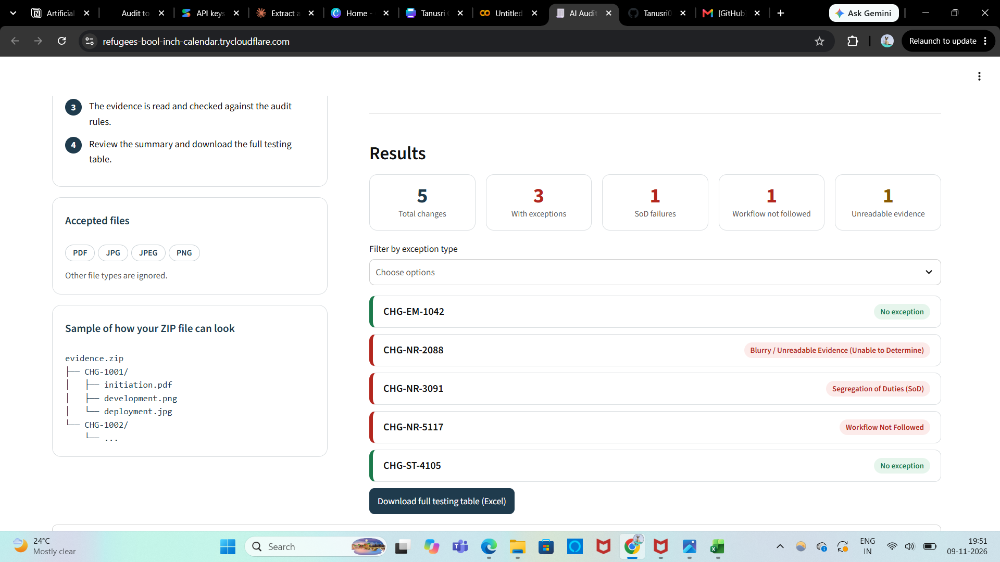
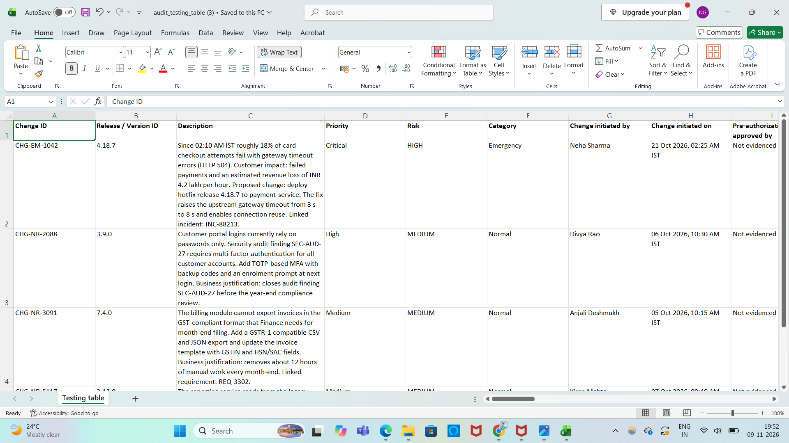
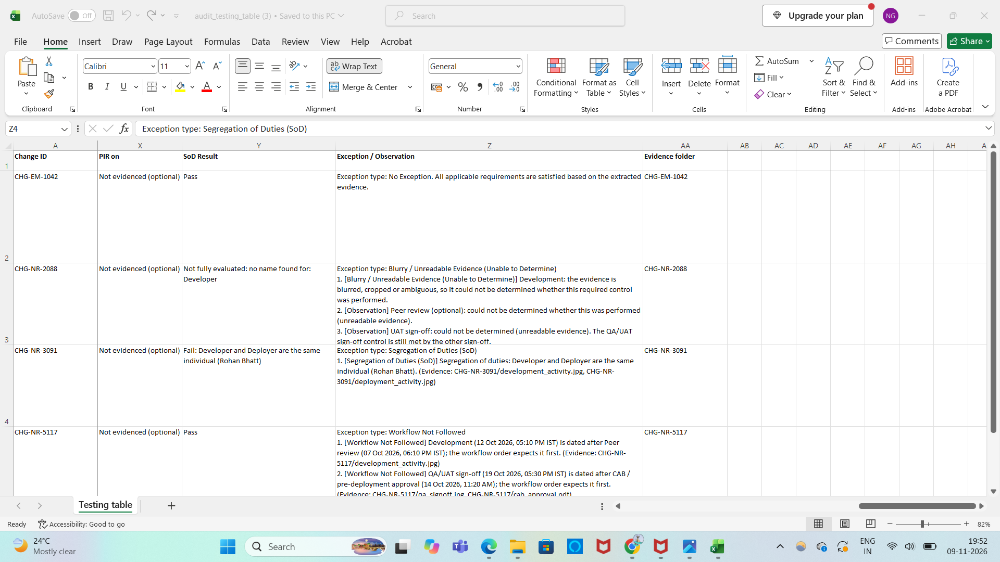

# AI Audit Companion

Upload a ZIP of change-request evidence (PDF, JPG, JPEG, PNG), one folder per change request. The evidence is read
automatically and checked against IT Change Management audit rules, producing an audit testing table (Excel).

## How it works
1. `zip_to_llm.py` extracts the ZIP to a temporary folder and groups files by change folder.
2. `audit_extractor.py` sends the evidence to Gemini, which only **extracts** fields (`audit_prompt.py`, `schema.py`).
3. `rules_engine.py` applies the rules in `workflows.py` (category, workflow order, controls, segregation of duties)
   and classifies exceptions. These decisions are made by plain Python, not by the model.
4. `app.py` (Streamlit) shows the summary and offers the Excel testing table.

## Run locally
```
pip install -r requirements.txt
export GEMINI_API_KEY="your-key"      # Windows PowerShell: $env:GEMINI_API_KEY="your-key"
streamlit run app.py
```
Or put `GEMINI_API_KEY = "your-key"` in `.streamlit/secrets.toml` (this file is git-ignored). Never commit the key.

## Tests
```
python test_zip_to_llm.py && python test_rules_engine.py && python test_extraction_parsing.py && python test_folders.py
```
No API key is needed for the tests.

## Notes
- Free Gemini tiers have small daily request limits; several change folders are batched per request.
- Tested on a small synthetic evidence pack. Not a replacement for auditor judgement.
- Future scope: auditor re-review of selected changes, and other domains/sources (e.g. AWS, Azure DevOps).

## Screenshots




